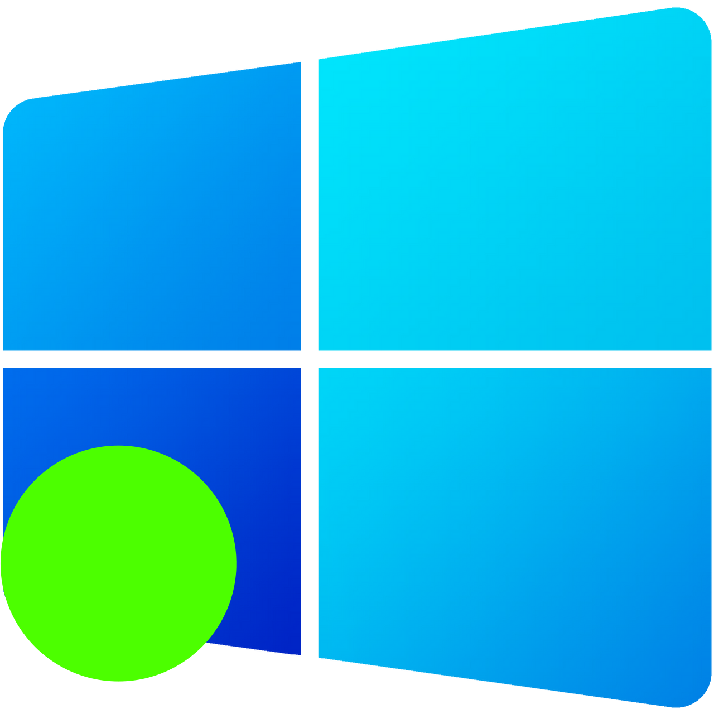
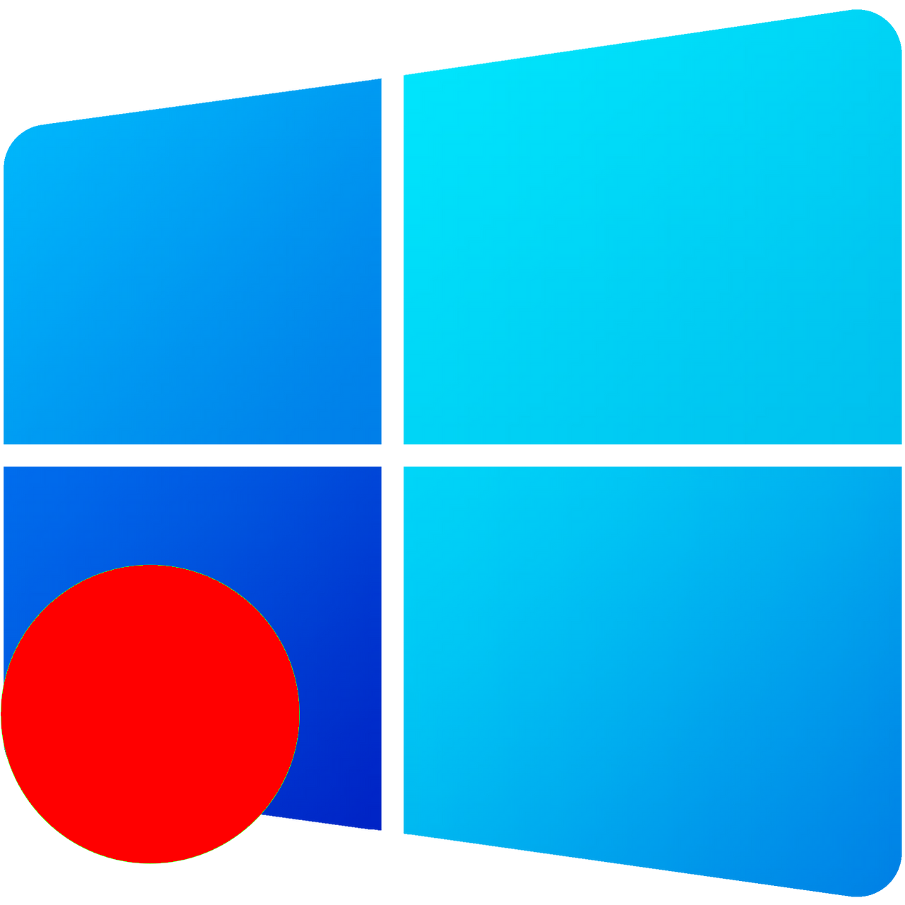

# homelab-gaming

This guide helps transform a Linux PC into a hybrid TV / PC gaming station using GPU passthrough.

## 🧩 Introduction

This repository documents:

- A **PC hosting a virtual machine (VM)** with **GPU passthrough** used as a gaming station.
- The VM is **connected to a TV** for family gaming with wireless controllers.
- The same VM can also be used from the **PC desktop** if needed for gaming.
- The PC can still be used as a classic computer.

## 🖥️ Host

| Component      | Details                     |
|----------------|-----------------------------|
| CPU            | AMD Ryzen 9 9900X           |
| GPU            | AMD Radeon™ RX 7800 XT      |
| Display        | HDMI output to TV + screen  |
| Controller     | Xbox                        |

## 🖥️ System

| Component      | Details                                    |
|----------------|--------------------------------------------|
| OS             | Ubuntu 25.10 or Ubuntu 26.04               |
| Hypervisor     | QEMU + libvirt                             |
| VM OS          | Windows 10                                 |

## Part 1 - Host Configuration (Ubuntu)

### Isolate GPU and USB

Run the GPU passthrough script to isolate the graphics card:

```bash
cd gpu_passthrough/
sudo ./config.sh
```

Edit the file `/etc/libvirt/qemu.conf` to add `/dev/kvmfr0`:

```bash
$ sudo vim /etc/libvirt/qemu.conf

cgroup_device_acl = [
    "/dev/null", "/dev/full", "/dev/zero",
    "/dev/random", "/dev/urandom",
   "/dev/ptmx", "/dev/kvm",
    "/dev/userfaultfd",
    "/dev/kvmfr0"
]

sudo systemctl restart libvirtd
```

Restart the machine and run a second time to verify isolation:

```bash
cd gpu_passthrough/
sudo ./check.sh
```

### Import the VM

VM Import:

```bash
cd vm_qemu
./import_vm.sh
```

### Install & Config Looking Glass Client

```bash
cd looking_glass
sudo ./install.sh
```

The application is available via the icon:

</td>
</td>

## Part 2 - VM Configuration

Install the following components:

### GPU Status via API

- **Python + API server**: to get the VM status from the host
  * scripts_vm/status_gpu.py
  * scripts_vm/status_gpu.bat

### Accessing the VM from the host
  * Looking Glass Host: installation of the "host" binary https://looking-glass.io/artifact/stable/host

### AutoHotkey
  * Install AutoHotkey https://www.autohotkey.com/ to add extra shortcuts with controllers
  * Used to close the switch emulator from an Xbox controller, for example
  * Deploy scripts `autohotkey/xinput.ahk` and `autohotkey/gamepad.ahk`
  * Set to start automatically with the VM

### SoundSwitch
  * Quickly switch sound cards via keyboard shortcut → useful for switching between PC and HDMI TV
  * Install the software https://soundswitch.aaflalo.me/
  * GitHub project https://github.com/Belphemur/SoundSwitch

### OpenRGB
  * To disable graphics card LEDs
    https://openrgb.org/

### Switch 1 Emulator
  * Install the Ryujinx emulator https://ryujinx.app/ Nintendo Switch 1 Emulator

### Firewall
  * Enable the firewall and block all incoming and outgoing traffic
    Exception for incoming tcp/8081 traffic
